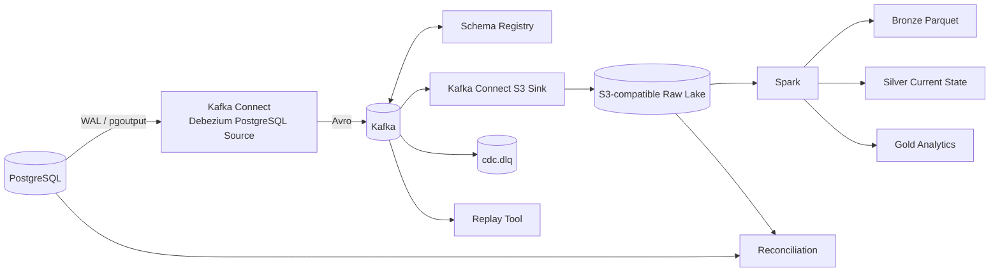

# postgres-kafka-cdc-platform

A production-style **Change Data Capture (CDC)** platform that captures PostgreSQL WAL changes with Debezium, serializes them with Avro, governs schemas in Schema Registry, lands the changelog in S3-compatible object storage through Kafka Connect, and materializes analytics-ready datasets with Spark.

The repository is designed as a **senior Data Engineer portfolio project**: it demonstrates delivery semantics, schema governance, idempotency, failure isolation, replay, checkpointing, data reconciliation, containerized operations, and CI—not just a happy-path Kafka demo.

## Architecture



## What this project proves

| Capability | Implementation |
|---|---|
| PostgreSQL CDC | Logical WAL + `pgoutput` + Debezium replication slot |
| Event backbone | Kafka in KRaft mode |
| Serialization | Avro converters |
| Schema governance | Schema Registry + `BACKWARD_TRANSITIVE` compatibility |
| Source EOS | Kafka Connect exactly-once source support + Debezium `required` mode |
| Downstream idempotency | topic/partition/offset identity + deterministic S3/Spark retries |
| Data lake | Kafka Connect S3 sink to Moto S3 emulator |
| Analytics | PySpark bronze/silver/gold Parquet datasets |
| Schema evolution | Nullable field migration + new Avro schema version |
| DLQ | Kafka Connect error tolerance + `cdc.dlq` |
| Replay | Offset-range raw-byte replay with `read_committed` isolation |
| Checkpointing | S3-backed processed-object manifest committed after successful writes |
| Data quality | Source-vs-CDC current-state count/checksum reconciliation |
| Testing | Pytest + Ruff + GitHub Actions |

## Technology stack

**PostgreSQL 17 · Debezium 3.7 · Apache Kafka/Kafka Connect · Avro · Confluent Schema Registry · Aiven S3 Sink Connector · Moto S3 emulator · Apache Spark 4.2 / PySpark · Python 3.12 · Docker Compose · GitHub Actions**

Debezium 3.7 is the current stable release line and its container tutorial runs Kafka Connect against current Kafka 4.x. Spark's current documentation is 4.2.0. The S3 sink is the Apache-2.0 Aiven connector and supports JSONL/Parquet plus custom S3 endpoints, which makes the same connector usable against local S3-compatible storage and AWS S3-style APIs.

## Quick start

Prerequisites: Docker Desktop/Engine with Compose, Python 3.11+, `curl`, and approximately 8 GB of free memory for a comfortable local run.

```bash
cp .env.example .env
python3 -m venv .venv
source .venv/bin/activate
pip install -e '.[dev]'

make up
make demo
```

`make up` starts PostgreSQL, Kafka, Schema Registry, Moto S3 emulator and Kafka Connect, creates the DLQ topic, enforces schema compatibility, and idempotently registers both connectors.

`make demo` generates inserts/updates, waits for the S3 connector flush, runs Spark, and verifies that the current database state can be reconstructed from the raw CDC log.

## Demo scenarios

### 1. Normal CDC lifecycle

```bash
make seed
make wait-raw
make spark
make reconcile
```

### 2. Generate load

```bash
make load N=10000
make wait-raw
make spark
make reconcile
```

Do not place throughput numbers on your resume until you have measured them on your own machine/environment.

### 3. Schema evolution

```bash
make evolve
sleep 12
make schemas
make spark
```

This adds `orders.sales_channel`, emits new CDC events, and creates a new schema version while keeping backward-transitive compatibility.

### 4. Dead-letter queue

```bash
make dlq-demo
```

A deliberately malformed non-Avro record is written directly to the orders topic. The sink's converter failure is tolerated and routed to `cdc.dlq` with context headers.

### 5. Replay

```bash
make replay TOPIC=cdc.public.orders START=0 END=50
```

The replay utility republishes raw Kafka bytes to `replay.cdc.public.orders`; it does not deserialize and reserialize Avro, so the original Schema Registry wire representation is preserved.

## Data-lake layout

```text
s3://cdc-lake/
├── raw/
│   ├── cdc.public.customers/year=.../month=.../day=.../*.jsonl
│   ├── cdc.public.orders/year=.../month=.../day=.../*.jsonl
│   └── cdc.public.order_items/year=.../month=.../day=.../*.jsonl
├── analytics/
│   ├── bronze/run=<content-derived-run-id>/*.parquet
│   ├── silver/customers/current/*.parquet
│   ├── silver/orders/current/*.parquet
│   ├── silver/order_items/current/*.parquet
│   └── gold/orders_by_status/current/*.parquet
└── checkpoints/
    └── spark/processed-raw-objects.json
```

## Delivery semantics: the important nuance

The Debezium source runs with Kafka Connect EOS enabled. That is a meaningful guarantee for the **PostgreSQL → Kafka** source path. This repository does not make the misleading claim that every external system automatically participates in one global distributed transaction.

For **Kafka → S3 → Spark**, correctness comes from idempotency: Kafka offsets are stable event identities, S3 object names encode offsets, Spark drops duplicate event IDs, analytic outputs are deterministically replaced, and the checkpoint is advanced only after writes complete.

See [`docs/architecture.md`](docs/architecture.md) for the design rationale.

## Operational endpoints

- Kafka: `localhost:9092`
- PostgreSQL: `localhost:5432`
- Schema Registry: `http://localhost:8081`
- Kafka Connect REST: `http://localhost:8083`
- Local S3 emulator API: `http://localhost:9000`
- Optional Kafka UI: `http://localhost:8080`

Start the optional UI with:

```bash
docker compose --profile ui up -d kafka-ui
```

## Tests and CI

```bash
make lint
make test
```

The default GitHub Actions workflow runs static checks and unit tests. A separate manual integration workflow builds the Docker stack, generates CDC, verifies connector/schema health, runs Spark, and executes reconciliation.

## Resume-ready bullets

- Built an end-to-end PostgreSQL CDC data platform using Debezium, Kafka/Kafka Connect, Avro Schema Registry, S3-compatible object storage, and PySpark to transform WAL changes into analytics-ready Parquet datasets.
- Enabled Kafka Connect exactly-once source transactions for Debezium PostgreSQL and designed downstream idempotency using topic/partition/offset event identity, deterministic object naming, de-duplication, and checkpoint-on-success processing.
- Implemented backward-transitive Avro schema evolution, Kafka Connect DLQs, raw-message replay, Spark checkpoints, and source-to-lake checksum reconciliation for recoverability and data correctness.

More positioning guidance is in [`docs/resume-and-interview.md`](docs/resume-and-interview.md).

## Production evolution

For a real AWS deployment, replace the local services with RDS/Aurora PostgreSQL, MSK or Confluent Cloud, S3, and Spark on EMR/Glue; then add multi-AZ brokers and Connect workers, IAM, TLS/SASL, ACLs, Secrets Manager, private endpoints, lag/WAL-retention alerting, autoscaling, lifecycle policies, and Apache Iceberg (or another transactional table format) for concurrent analytics-table updates.

## License

MIT. Third-party images/connectors retain their own licenses.
